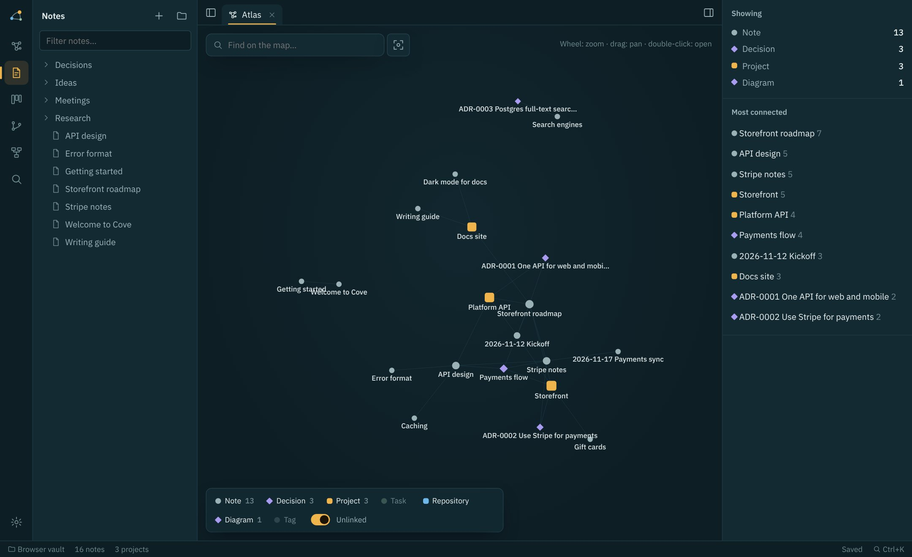

<p align="center"></p>

<h1 align="center">Cove</h1>
<p align="center"><b>designed by Rumet</b></p>

<p align="center">
Notların, projelerin, depoların ve mimarin tek haritada. Notlar bilgisayarındaki Markdown dosyalarıdır.<br>
<i>Your notes, projects, repositories and architecture on one map. Notes are Markdown files on your computer.</i>
</p>

<p align="center">
  <a href="https://github.com/rumetsasmaz/cove-releases/releases/latest/download/Cove-Setup.exe"><b>⬇ Windows için indir / Download for Windows</b></a>
  &nbsp;·&nbsp;
  <a href="https://rumetsasmaz.github.io/cove-releases/">🌐 Web sitesi / Website</a>
</p>

<p align="center"></p>

**Cove 2'den geliyorsan / Coming from Cove 2:** güncelleme kendiliğinden gelir; notların, günlüğün, projelerin ve yapılacakların ilk açılışta `Cove 2` klasörüne aktarılır. *The update installs itself; your notes, journal, projects and to-dos are imported into a `Cove 2` folder on first start.*

## İndir / Download

| | |
|---|---|
| **Sürüm / Version** | 3.0.27 (2026-11-18) |
| **Sistem / System** | Windows 10 / 11, 64-bit |
| **Dosya / File** | [`Cove-Setup.exe`](https://github.com/rumetsasmaz/cove-releases/releases/latest/download/Cove-Setup.exe) |
| **SHA-256** | `244a526ce095fec1017dbcf2eb85cf1ff8f14cb99c08dffce5b8bbaaffc5c782` |

Windows "Bilgisayarınız korundu" derse **Ek bilgi → Yine de çalıştır**. Uygulama henüz ücretli bir kod imzalama sertifikasıyla imzalanmadığı için bu uyarı çıkar. Kurulduktan sonra güncellemeler kendiliğinden gelir.

*If Windows shows "Windows protected your PC", click **More info → Run anyway**. Updates install automatically.*

## 🛡 Sadece resmi indirme / Official downloads only

Cove'un tek resmi kaynağı bu repo ve web sitesidir. İndirdiğin dosyanın değiştirilmediğini doğrulamak için PowerShell'de çalıştır:

```powershell
Get-FileHash .\Cove-Setup.exe
```

Çıkan kod yukarıdaki **SHA-256** ile aynı olmalıdır. *The result must match the SHA-256 above.*

## © Lisans / License

© 2026 Rumet. Tüm hakları saklıdır / All rights reserved.
Bu repo yalnızca resmi kurulum dosyalarını içerir; kaynak kod gizlidir. Yazılımın kopyalanması, değiştirilmesi, yeniden dağıtılması, satılması veya tersine mühendislik yapılması yasaktır. Ayrıntılar: [LICENSE](LICENSE).
